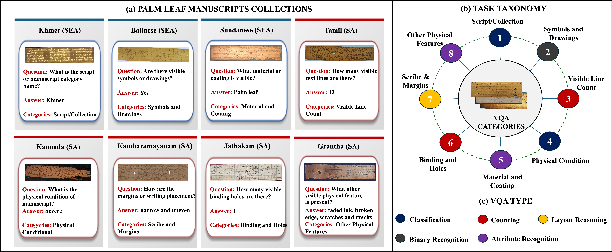

# PalmLeaf-VQA

**📍 WACV 2027 Disney Springs, Florida, USA**

🎉 **Accepted in the first round.**

**PalmLeaf-VQA: A Multi-Script Visual Question Answering Benchmark for Historical Palm-Leaf Manuscript Understanding Across Diverse Regions**

**Project lead: Nimol Thuon**

[🌐 Project webpage](https://back-kh.github.io/palmleaf-vqa/) | [📄 Read the preprint](https://arxiv.org/abs/2609.31651) | [Test set on Hugging Face](https://huggingface.co/datasets/Backkh/PalmLeaf-VQA) | [🗺️ Project roadmap](#roadmap) | [📖 Citation](#citation)

## 🔎 Overview

PalmLeaf-VQA is a visual question answering benchmark for historical palm-leaf manuscript images from South and Southeast Asian collections. It evaluates observable manuscript properties, including physical condition, visible line structure, symbols and drawings, material-related attributes, binding holes, and margins.

The benchmark focuses on manuscript layout and physical attributes. It does not evaluate full-text transcription, translation, or understanding of the manuscripts' textual content.

## 🖼️ Benchmark Overview



*Figure 1 adapted from the [paper](https://arxiv.org/abs/2609.31651), with the Grantha example question corrected to "What other visible physical feature is present?" to match its answer and category. The overview presents representative manuscript collections and QA examples, the question taxonomy, and five task types: classification, counting, layout reasoning, binary recognition, and attribute recognition.*

## 📌 Current Status

**WACV 2027 accepted.** The [project webpage](https://back-kh.github.io/palmleaf-vqa/) is live, and the reviewed test set is publicly available on [Hugging Face](https://huggingface.co/datasets/Backkh/PalmLeaf-VQA) for **non-commercial use only**. The [test ZIP](https://huggingface.co/datasets/Backkh/PalmLeaf-VQA/resolve/main/PalmLeaf-VQA-Test-Images-QA.zip) contains **278 manuscript image records** and **2,224 approved question-answer pairs**.

### 📰 News

- **November 24, 2026:** Six [new model evaluations](#model-benchmarks) have been added alongside the paper results for both prompt modes.
- **November 23, 2026:** The [project webpage](https://back-kh.github.io/palmleaf-vqa/) went live and the [test dataset](https://huggingface.co/datasets/Backkh/PalmLeaf-VQA) was released.
- **WACV 2027:** PalmLeaf-VQA has been accepted in the first round.
- **September 14, 2026:** The first [preprint](https://arxiv.org/abs/2609.31651) became available on arXiv.

## Roadmap

| Step | Milestone | Status | Details |
| --- | --- | --- | --- |
| 1 | First preprint published | ✅ Complete | Paper available on arXiv. |
| 2 | WACV 2027 acceptance | ✅ Complete | Accepted in the first round. |
| 3 | Project webpage launch | ✅ Complete | The [project webpage](https://back-kh.github.io/palmleaf-vqa/) is live with examples, paper results, and download links. |
| 4 | Test dataset release | ✅ Complete | Test images and reviewed QA are available on [Hugging Face](https://huggingface.co/datasets/Backkh/PalmLeaf-VQA) for non-commercial use only. |
| 5 | Paper benchmark evaluation | ✅ Complete | The [paper's model performance tables](https://arxiv.org/html/2609.31651v1#S5) report test-set results without task-specific fine-tuning. |
| 6 | Full benchmark paper and materials | ✅ Complete | The [preprint and supplement](https://arxiv.org/html/2609.31651v1) include the benchmark tables and evaluation protocol. |
| 7 | Newer-model benchmark updates | ✅ Published | The [benchmark table](#model-benchmarks) includes six post-paper evaluations marked (New). |
| 8 | Training and validation release and follow-up benchmark | ⏳ Planned | Release training and validation annotations, split identifiers, and access instructions. Use training data for fine-tuning and validation data for model selection, then check for overlap before evaluating on the test set. |

Release links and completion dates will be added here as each milestone is reached. Planned milestones are not announcements of completed releases.

## 📊 Benchmark at a Glance

As described in the paper, PalmLeaf-VQA contains **923 manuscript images** and **7,384 question-answer pairs**, with eight questions per image across eight categories.

| Split | Images | Question-answer pairs |
| --- | ---: | ---: |
| Train | 553 | 4,424 |
| Validation | 92 | 736 |
| Test | 278 | 2,224 |
| **Total** | **923** | **7,384** |

The split counts refer to manuscript image records.

## Model Benchmarks

<a name="model-benchmarks-new-evaluations"></a>

Models marked (New) were evaluated after the paper. The [project webpage benchmark table](https://back-kh.github.io/palmleaf-vqa/#benchmark) reports the same scores. Bold marks the highest reported score for each metric and prompt mode within the proprietary and open-weight groups.

| Model | Mode | Exact acc. | Mean F1 | Mean Jaccard | Line count &plusmn;1 |
| --- | --- | ---: | ---: | ---: | ---: |
| **Proprietary vision-language models** | | | | | |
| GPT-6.2 Sol (Max) (New) | Constrained | **62.37%** | **73.87%** | **71.53%** | **98.20%** |
| GPT-6.2 Sol (Max) (New) | Open | 46.27% | 48.07% | 47.36% | 97.48% |
| GPT-6.2 Astra (Max) (New) | Constrained | 59.22% | 69.72% | 67.54% | **98.20%** |
| GPT-6.2 Astra (Max) (New) | Open | **48.04%** | **49.75%** | **49.07%** | **97.84%** |
| Gemini 3.5 Flash | Constrained | 58.00% | 67.25% | - | 93.88% |
| Gemini 3.5 Flash | Open | 43.03% | 43.31% | - | 95.13% |
| ChatGPT 5.5 | Constrained | 55.40% | 66.17% | - | 93.53% |
| ChatGPT 5.5 | Open | 40.50% | 39.16% | - | 94.68% |
| Gemini 3.1 Flash Lite | Constrained | 47.53% | 58.80% | - | 74.28% |
| Gemini 3.1 Flash Lite | Open | 39.52% | 39.58% | - | 75.72% |
| **Open-weight vision-language models** | | | | | |
| Qwen3.8-Flash-Next (New) | Constrained | **49.91%** | **56.72%** | **54.63%** | - |
| Qwen3.8-Flash-Next (New) | Open | 32.37% | 32.58% | 32.50% | - |
| DeepSeek-V4.1-Flash (New) | Constrained | 48.92% | 53.25% | 51.67% | - |
| DeepSeek-V4.1-Flash (New) | Open | 27.70% | 28.18% | 28.06% | - |
| GLM-5.3-Flash (New) | Constrained | 48.02% | 54.55% | 52.52% | - |
| GLM-5.3-Flash (New) | Open | 34.44% | 34.55% | 34.51% | - |
| InternVL3.5-4B | Constrained | 46.00% | 54.93% | - | 59.71% |
| InternVL3.5-4B | Open | 24.96% | 25.12% | - | 65.65% |
| InternVL3.5-8B | Constrained | 44.96% | 54.48% | - | 62.05% |
| InternVL3.5-8B | Open | 24.78% | 25.02% | - | 61.51% |
| Qwen3.8-27B (New) | Constrained | 44.38% | 49.51% | 47.72% | - |
| Qwen3.8-27B (New) | Open | **34.76%** | **34.77%** | **34.77%** | - |
| Qwen3-VL-8B | Constrained | 44.02% | 54.73% | - | **71.22%** |
| Qwen3-VL-8B | Open | 21.49% | 21.80% | - | 68.60% |
| Qwen2.5-VL-3B | Constrained | 35.21% | 41.71% | - | 56.29% |
| Qwen2.5-VL-3B | Open | 15.15% | 15.61% | - | 54.33% |
| Qwen2.5-VL-7B | Constrained | 31.03% | 37.41% | - | 61.87% |
| Qwen2.5-VL-7B | Open | 13.62% | 13.95% | - | **71.92%** |
| Gemma-3-4B-IT | Constrained | 30.94% | 40.13% | - | 14.75% |
| Gemma-3-4B-IT | Open | 19.29% | 21.58% | - | 29.50% |
| **Text-only controls** | | | | | |
| Llama-3.1-8B | Constrained | 31.65% | 34.05% | - | 34.35% |
| Llama-3.1-8B | Open | 8.00% | 8.00% | - | 3.96% |
| Llama-3.2-3B | Constrained | 26.26% | 26.26% | - | 23.92% |
| Llama-3.2-3B | Open | 7.91% | 7.91% | - | 0.00% |

Line count &plusmn;1 is the percentage of answers within one line of the reference count. A dash means not reported.

**Parameters:** [DeepSeek-V4.1-Flash](https://arxiv.org/html/2609.19969v1) has a 552B backbone plus 196B Engram parameters, with 8B active during prefill and 16B during decoding. [Qwen3.8-Flash-Next](https://huggingface.co/Qwen/Qwen3.8-Flash-Next) has a 125B main model with 6B active, plus 51B n-gram embeddings and a 4B multi-token prediction module. [GLM-5.3-Flash](https://huggingface.co/zai-org/GLM-5.3-Flash) has 320B total and 18B active parameters. [Qwen3.8-27B](https://huggingface.co/Qwen/Qwen3.8-27B) is a 27B dense model.

The [paper scores](https://arxiv.org/html/2609.31651v1#S5) are unchanged. The GPT-6.2 Max runs used Codex CLI with the archived prompts and original WACV test labels rather than the paper's API runner. Each GPT mode scored 2,224 answers except Astra open, which scored 2,221 after three script-identification timeouts. The other new scores are reported as supplied.

## Python Quick Start

Download the [test-set ZIP](https://huggingface.co/datasets/Backkh/PalmLeaf-VQA/resolve/main/PalmLeaf-VQA-Test-Images-QA.zip) and run the [Python example](examples/inspect_test_set.py) from this repository. It uses only the Python standard library and reads annotations directly from the archive.

```bash
python3 examples/inspect_test_set.py PalmLeaf-VQA-Test-Images-QA.zip
python3 examples/inspect_test_set.py PalmLeaf-VQA-Test-Images-QA.zip --image Khmer_0009.jpg
```

The first command shows counts by collection. The second prints the selected image's question-answer pairs and its path inside the ZIP.

## 🌏 Scripts and Collections

PalmLeaf-VQA covers the following eight script/collection groups:

| Script / collection group | Images | Question-answer pairs |
| --- | ---: | ---: |
| Balinese | 100 | 800 |
| Grantha | 70 | 560 |
| Jathakam | 99 | 792 |
| Kambaramayanam | 80 | 640 |
| Kannada | 257 | 2,056 |
| Khmer | 155 | 1,240 |
| Sundanese | 61 | 488 |
| Tamil | 101 | 808 |
| **Total** | **923** | **7,384** |

These names identify source collections or manuscript traditions and do not necessarily correspond one-to-one to distinct scripts. Counts reflect the benchmark described in the paper.

## 🧾 Release and Evaluation Notes

- The test dataset is for **non-commercial use only**. Training and validation data are not yet released.
- Image access and redistribution will follow the original sources' terms. Restricted-source material will require source identifiers and retrieval instructions rather than unauthorized image redistribution.
- Annotation corrections and benchmark updates will be versioned. Results reported in the paper belong to the annotation version used for those experiments; corrected test labels require rescoring before results can be associated with the revised version.
- Future evaluations will document model versions, prompts, decoding settings, and scoring rules. New results will be distinguished from those reported in the accepted paper.

## Citation

Until the proceedings version is available, please cite the preprint:

```bibtex
@misc{thuon2026palmleafvqa,
  title={PalmLeaf-VQA: A Multi-Script Visual Question Answering Benchmark for Historical Palm-Leaf Manuscript Understanding Across Diverse Regions},
  author={Nimol Thuon and Jun Du and Panhapin Theang},
  year={2026},
  eprint={2609.31651},
  archivePrefix={arXiv},
  primaryClass={cs.CV},
  url={https://arxiv.org/abs/2609.31651}
}
```

## 📬 Contact

For questions about the benchmark and planned releases, contact **Nimol Thuon** at [nimol.thuon@gmail.com](mailto:nimol.thuon@gmail.com).

*Last updated: November 24, 2026.*
