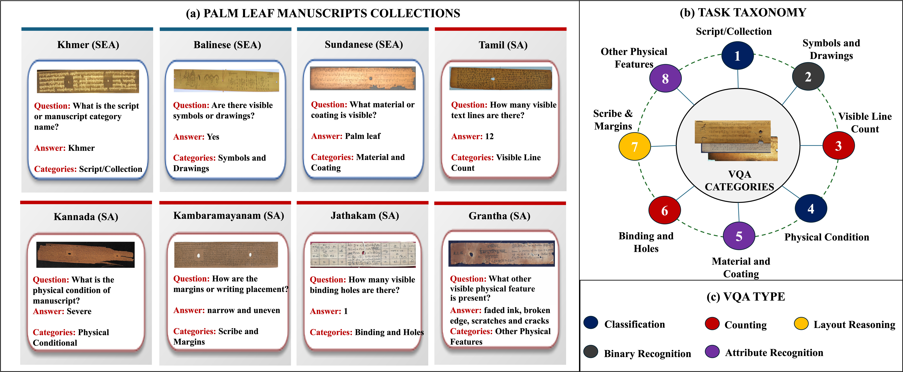

# PalmLeaf-VQA

**📍 WACV 2027 Disney Springs, Florida, USA**

🎉 **Accepted in the first round.**

**PalmLeaf-VQA: A Multi-Script Visual Question Answering Benchmark for Historical Palm-Leaf Manuscript Understanding Across Diverse Regions**

**Project lead: Nimol Thuon**

[📄 Read the preprint](https://arxiv.org/abs/2609.31651) | [🗺️ Project roadmap](#roadmap) | [📖 Citation](#citation)

## 🔎 Overview

PalmLeaf-VQA is a visual question answering benchmark for historical palm-leaf manuscript images from South and Southeast Asian collections. It evaluates observable manuscript properties, including physical condition, visible line structure, symbols and drawings, material-related attributes, binding holes, and margins.

The benchmark focuses on manuscript layout and physical attributes. It does not evaluate full-text transcription, translation, or understanding of the manuscripts' textual content.

## 🖼️ Benchmark Overview



*Figure 1 adapted from the [paper](https://arxiv.org/abs/2609.31651), with the Grantha example question corrected to "What other visible physical feature is present?" to match its answer and category. The overview presents representative manuscript collections and QA examples, the question taxonomy, and five task types: classification, counting, layout reasoning, binary recognition, and attribute recognition.*

## 📌 Current Status

**Current milestone: WACV 2027 accepted.** The preprint is publicly available. The project webpage, dataset releases, full benchmark materials, and newer-model evaluations are planned next steps; they are not yet released through this repository.

### 📰 News

- **WACV 2027:** PalmLeaf-VQA has been accepted in the first round.
- **September 14, 2026:** The first [preprint](https://arxiv.org/abs/2609.31651) became available on arXiv.

## Roadmap

| Step | Milestone | Status | Details |
| --- | --- | --- | --- |
| 1 | First preprint published | ✅ Complete | Paper available on arXiv. |
| **2** | **WACV 2027 acceptance** | **✅ Current milestone - complete** | **Accepted in the first round.** |
| 3 | Project webpage update | ⏳ Planned | Benchmark overview, examples, and links to project resources. |
| 4 | Test dataset release | ⏳ Planned | Reviewed test annotations, split identifiers, and data-access instructions. |
| 5 | Training and validation dataset release | ⏳ Planned | Training/validation annotations, split identifiers, and data-access instructions. |
| 6 | Full benchmark paper and materials | ⏳ Planned | Final conference paper, supplementary materials, evaluation code, and protocol documentation. |
| 7 | Newer-model benchmark updates | ⏳ Planned | Versioned evaluations of larger and newer multimodal models. |

Release links and completion dates will be added here as each milestone is reached. Planned milestones are not announcements of completed releases.

## 📊 Benchmark at a Glance

As described in the paper, PalmLeaf-VQA contains **923 manuscript images** and **7,384 question-answer pairs**, with eight questions per image across eight categories.

| Split | Images | Question-answer pairs |
| --- | ---: | ---: |
| Train | 553 | 4,424 |
| Validation | 92 | 736 |
| Test | 278 | 2,224 |
| **Total** | **923** | **7,384** |

The reported splits are image-disjoint, not guaranteed to be fully manuscript-disjoint.

## 🌏 Scripts and Collections

PalmLeaf-VQA covers the following eight script/collection groups:

| Script / collection group | Images | Question-answer pairs |
| --- | ---: | ---: |
| Balinese | 100 | 800 |
| Grantha | 70 | 560 |
| Jathakam | 99 | 792 |
| Kambaramayanam | 80 | 640 |
| Kannada | 257 | 2,056 |
| Khmer | 155 | 1,240 |
| Sundanese | 61 | 488 |
| Tamil | 101 | 808 |
| **Total** | **923** | **7,384** |

These names identify source collections or manuscript traditions and do not necessarily correspond one-to-one to distinct scripts. Counts reflect the benchmark described in the paper.

## 🧾 Release and Evaluation Notes

- Dataset downloads and evaluation code are not yet available in this repository. Their release status will be updated in the roadmap.
- Image access and redistribution will follow the original sources' terms. Restricted-source material will require source identifiers and retrieval instructions rather than unauthorized image redistribution.
- Annotation corrections and benchmark updates will be versioned. Results reported in the paper belong to the annotation version used for those experiments; corrected test labels require rescoring before results can be associated with the revised version.
- Future evaluations will document model versions, prompts, decoding settings, and scoring rules. New results will be distinguished from those reported in the accepted paper.

## Citation

Until the proceedings version is available, please cite the preprint:

```bibtex
@misc{thuon2026palmleafvqa,
  title={PalmLeaf-VQA: A Multi-Script Visual Question Answering Benchmark for Historical Palm-Leaf Manuscript Understanding Across Diverse Regions},
  author={Nimol Thuon and Jun Du and Panhapin Theang},
  year={2026},
  eprint={2609.31651},
  archivePrefix={arXiv},
  primaryClass={cs.CV},
  url={https://arxiv.org/abs/2609.31651}
}
```

## 📬 Contact

For questions about the benchmark and planned releases, contact **Nimol Thuon** at [nimol.thuon@gmail.com](mailto:nimol.thuon@gmail.com).

*Last updated: November 7, 2026.*
